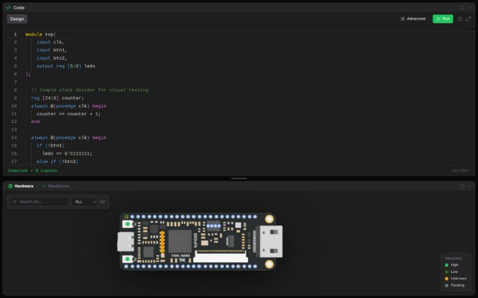
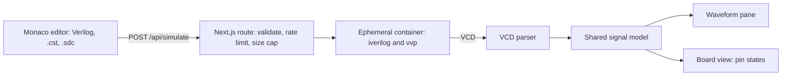
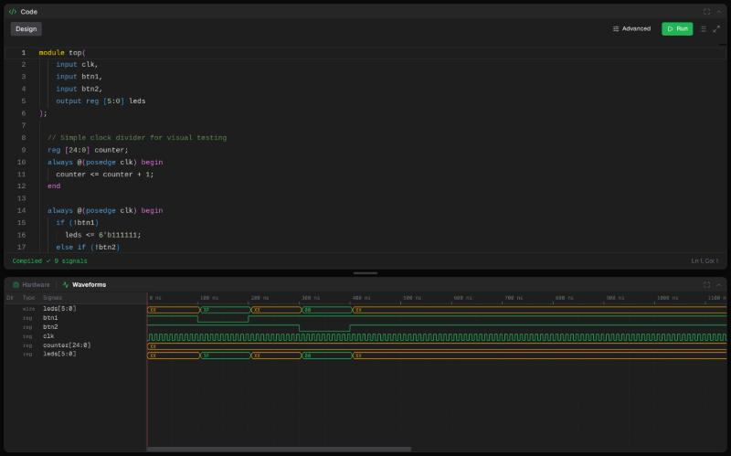
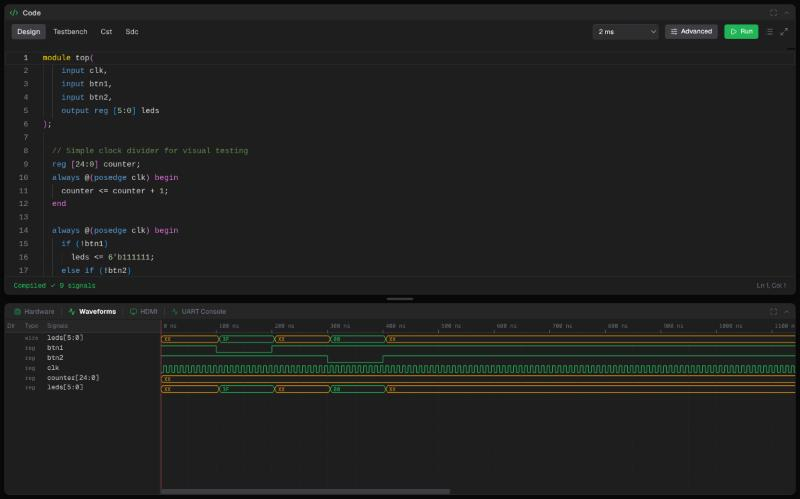

# fpgasim

**A browser-based simulator for the Sipeed Tang Nano 9K FPGA.** Write Verilog and real Gowin constraint files, press Run, and watch the design drive a virtual board and its waveforms. No toolchain install and no hardware needed.

Live demo: **https://nika.pontsho-mbizo.co.za**

<p align="center"></p>

*The default design after pressing Run: 9 signals compiled, with the board's pins lit by their simulated state.*

## How it works



- **Board emulation.** The design is wired to the Tang Nano 9K's real pins and peripherals (LEDs, buttons, UART, HDMI). Pin mapping comes from an authentic Gowin `.cst` file and the clock from an `.sdc` file, both validated before the run.
- **Stimulus blocks.** Drive inputs from visual signal sources (presets, sample tables or Verilog) instead of hand-writing a testbench.
- **Basic and Advanced modes.** Basic is the editor and a Run button. Advanced adds the testbench, constraint and timing tabs, a simulation-duration selector, and HDMI and UART console panes.
- **Sandbox.** Verilog from anyone on the internet runs in a throwaway container with no network, a read-only filesystem and a non-root user. Memory, process count, runtime and output size are all capped (see Findings).

<p align="center"></p>

*Waveforms from the same run: the stimulus presses btn1 and btn2, and `leds` changes in response. Advanced mode (below) exposes the Testbench, Cst and Sdc tabs and the duration selector.*

<p align="center"></p>

## Design choices

| Decision | Why |
|---|---|
| Batch and scrub: run once, then scrub a time cursor | Keeps the backend stateless and the sandbox simple, with no long-lived sessions to secure |
| Icarus Verilog in a minimal Alpine container | Small attack surface and fast start. Enough for functional simulation |
| Authentic Gowin `.cst` and `.sdc` syntax | What you write here carries over to the real Gowin toolchain |
| VCD as the only interface between backend and UI | The parser and signal model are shared, so the backend can change without touching the UI |
| Hard limits at three layers: route, container flags, host timer | A runaway or hostile design fails fast and is reported as a timeout, not a hung server |

## Findings

Measured on the live demo, 6 November 2026. Timings are from a browser, so they include the network round trip.

| Area | Result |
|---|---|
| Simulation round trip | 272 to 375 ms over 4 runs of the default 24-line design with an auto-generated testbench |
| Board model | 62 pins |
| Unit tests | 69 pass in about 0.4 s, Node only (parsers, board data, rules, harness, stimulus) |
| Sandbox limits | 12 s wall clock, 256 MB memory, 64 processes, 16 MiB of VCD output, 200 KiB of source |
| Request limits | 4 concurrent simulations, 30 requests per minute per IP |
| Stimulus limits | At most 16 blocks, 4096 samples each, 8192 in total |

### Limits of these results

- The timing sample is small (4 runs of one design) and was taken from one location.
- This is functional simulation only. There is no static timing analysis, so setup and hold are not checked. The `.sdc` sets the clock and a sanity summary.
- Button and peripheral inputs are pre-scripted, not live clicks.
- HDMI captures parallel video (one frame, size-capped), not deserialised TMDS.
- A few peripheral pin numbers are marked `// verify` in the board file pending a schematic cross-check.

## Run it locally

Requires Node 20+ and Docker or Podman.

```bash
npm install
docker build -t nika-sim -f Dockerfile.sim sim/   # sandbox image, once
npm run dev                                       # http://localhost:3000
```

```bash
npm run test:unit   # Node only
npm test            # includes the sandbox and board end-to-end tests (needs the nika-sim image)
```

CI runs the tests on Node 20 and 22. Examples live in `examples/` (start with `up-down-counter`).

## Docs

[Board emulation](docs/board-emulation.md), [simulation backend and threat model](docs/simulation-backend.md), [API](docs/API.md).

## Related

[mcusim](https://github.com/PontshoMbizo/mcusim): the same idea for the STM32 "Blue Pill", using QEMU and bare-metal C.

## Licence

TODO: add a licence file (MIT suggested).
